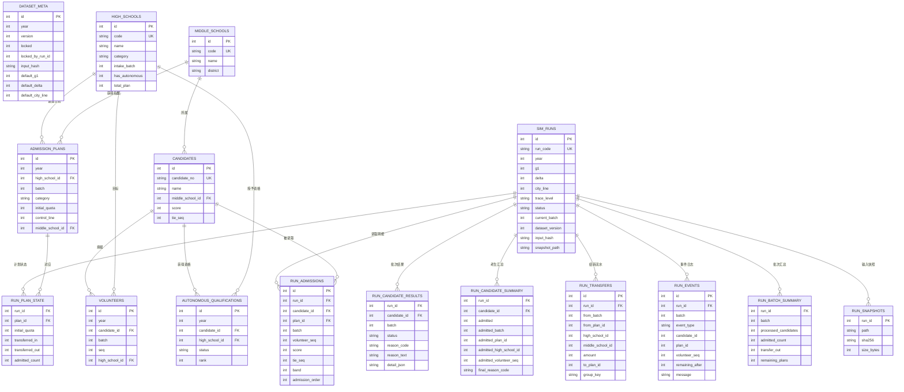

# 数据库设计

## 1. 设计原则

1. **输入与运行分离**：输入表保存当前数据版本；每次投档运行在 `sim_runs` 下生成独立的结果、计划状态、日志和快照，重新运行不会叠加旧录取。
2. **可追溯**：每条录取记录对应具体计划、志愿序号、梯度、计划内录取顺序；每次结转记录来源计划、去向计划、人数。
3. **可解释**：`run_candidate_results` 保存每个考生每个批次的状态与原因；完整追踪模式下还保存逐志愿处理明细。
4. **可复现**：`run_snapshots` 保存 gzip JSON 快照与 SHA-256；`dataset_meta` 记录数据版本、锁定状态和输入哈希。
5. **约束前置**：数据库 CHECK/UNIQUE 约束 + 应用层校验 + 运行后一致性校验三层防护。

## 2. ER 图



## 3. 输入表

### 3.1 `dataset_meta`

单行表，记录当前数据版本。

| 字段 | 类型 | 说明 |
| --- | --- | --- |
| id | INTEGER | 固定为 1 |
| year | INTEGER | 模拟年度 |
| version | INTEGER | 数据版本号，任何输入变更 +1 |
| updated_at | TEXT | 最近更新时间 |
| locked | INTEGER | 是否被运行锁定 |
| locked_by_run_id | INTEGER | 首次锁定该版本的运行 |
| input_hash | TEXT | 当前输入数据的规范化 SHA-256（不含运行参数） |
| generator_seed | INTEGER | 演示数据随机种子 |
| default_g1 / default_delta / default_city_line | INTEGER | 当前数据集推荐的规则参数 |
| note | TEXT | 备注 |

### 3.2 `high_schools`

| 字段 | 约束 | 说明 |
| --- | --- | --- |
| id | PK | 高中 ID |
| code | UNIQUE, NOT NULL | 高中编号 |
| name | NOT NULL | 名称 |
| category | CHECK 示范性/非示范 | 高中类型 |
| intake_batch | CHECK 3/4 | 统招接收批次 |
| has_autonomous | CHECK 0/1 | 是否获批自主招生 |
| total_plan | CHECK ≥0 | 总计划 |
| campus | TEXT | 校区/备注 |

约束：第四批高中不能设置自主招生；第一批、第二批计划只允许第三批高中。

### 3.3 `middle_schools`

| 字段 | 约束 | 说明 |
| --- | --- | --- |
| id | PK | 初中 ID |
| code | UNIQUE | 初中编号 |
| name | NOT NULL | 名称 |
| district | TEXT | 区 |

### 3.4 `candidates`

| 字段 | 约束 | 说明 |
| --- | --- | --- |
| id | PK | 考生 ID |
| candidate_no | UNIQUE | 考生编号 |
| name | NOT NULL | 虚构姓名 |
| middle_school_id | FK | 所属初中 |
| score | CHECK 0–750 | 总分 |
| tie_seq | CHECK >0 | 同分序号 |

约束：`UNIQUE(score, tie_seq)`，保证同一总分内同分序号唯一；不同分数可以使用相同序号。

### 3.5 `admission_plans`

| 字段 | 约束 | 说明 |
| --- | --- | --- |
| id | PK | 计划 ID |
| year | NOT NULL | 年度 |
| high_school_id | FK | 高中 |
| batch | CHECK 1–4 | 批次 |
| category | TEXT | 自主招生/名额分配/统招 |
| initial_quota | CHECK ≥0 | 初始名额 |
| control_line | CHECK ≥0 | 计划控制线 |
| middle_school_id | FK，第二批必填 | 名额分配初中 |

唯一键：`(year, high_school_id, batch, COALESCE(middle_school_id, -1))`，保证同一高中同批次同初中只有一条计划。CHECK 约束保证第二批必须有初中、其他批次必须为空。

### 3.6 `autonomous_qualifications`

| 字段 | 约束 | 说明 |
| --- | --- | --- |
| candidate_id | FK | 考生 |
| high_school_id | FK | 高中 |
| status | CHECK qualified/disqualified | 资格状态 |
| rank | 合格时必填 | 考核排名 |

唯一键：`(year, candidate_id, high_school_id)`；部分唯一索引保证同一高中 `rank` 唯一。

### 3.7 `volunteers`

| 字段 | 约束 | 说明 |
| --- | --- | --- |
| candidate_id | FK | 考生 |
| batch | CHECK 1–4 | 批次 |
| seq | CHECK 1–6 | 志愿序号 |
| high_school_id | FK | 目标高中 |

唯一键：`(year, candidate_id, batch, seq)` 和 `(year, candidate_id, batch, high_school_id)`，防止重复志愿序号和同批次重复填报同一高中。

## 4. 运行与结果表

### 4.1 `sim_runs`

| 字段 | 说明 |
| --- | --- |
| run_code | 运行编号，唯一 |
| g1 / delta / city_line | 本次运行规则参数 |
| trace_level | full/summary |
| status | created/batch1_done/…/completed/failed |
| current_batch | 已完成的最后批次 0–4 |
| dataset_version | 运行时的数据版本 |
| input_hash | 输入数据哈希 |
| snapshot_path / snapshot_sha256 | 快照路径与文件哈希 |
| created_at / finished_at | 时间 |

### 4.2 `run_plan_state`

每个运行、每条计划一行：

| 字段 | 说明 |
| --- | --- |
| initial_quota | 初始名额（快照值） |
| transferred_in | 转入数 |
| transferred_out | 转出数 |
| admitted_count | 已录取数 |
| 余额 | 计算值：initial + in − out − admitted |

### 4.3 `run_admissions`

| 字段 | 说明 |
| --- | --- |
| candidate_id | 考生，`UNIQUE(run_id, candidate_id)` 保证最多录取一次 |
| plan_id | 计划 |
| batch | 批次 |
| volunteer_seq | 实际录取的志愿序号 |
| score / tie_seq / band | 录取时分数、同分序号、梯度 |
| admission_order | 计划内录取顺序，`UNIQUE(run_id, plan_id, admission_order)` |

### 4.4 `run_candidate_results`

每个考生、每个批次一行：

- `status`：ADMITTED / NOT_ADMITTED / SKIPPED / INELIGIBLE
- `reason_code` / `reason_text`：批次级原因
- `detail_json`：完整追踪模式下的逐志愿明细（志愿序号、高中、处理结果、当时余额）

### 4.5 `run_candidate_summary`

“学生录取表”的物化结果：是否录取、录取批次、录取计划、录取高中、录取志愿、最终原因。用于快速查询和统计。

### 4.6 `run_transfers`

结转流水：

- `from_batch`：1 或 2
- `from_plan_id`：来源计划
- `middle_school_id`：第二批来源初中，第一批为空
- `amount`：结转人数
- `to_plan_id`：第三批目标计划
- `group_key`：按高中汇总的分组标识，如 `B2-H12`

### 4.7 `run_events`

投档事件日志：

- 批次开始/结束
- 录取（含当时余额）
- 跳过（完整追踪模式，含原因）
- 结转
- 结转异常

### 4.8 `run_batch_summary`

每个批次一行：处理考生数、录取数、结转转出数、仍有余额计划数、开始/完成时间。

### 4.9 `run_snapshots`

每个运行一行：快照路径、文件 SHA-256、压缩后字节数。

## 5. 关键约束与等式

1. 每名考生每次运行最多录取一次：`UNIQUE(run_id, candidate_id)` + 引擎跳过已录取考生。
2. 每条计划录取人数不超过可用名额：引擎在每次录取前检查 `remaining > 0`；运行后 `verify_run` 再校验。
3. 录取必须对应有效志愿：`verify_run` 检查 `(batch, volunteer_seq, high_school_id)` 是否与录取记录一致。
4. 名额平衡：`initial_quota + transferred_in − transferred_out = admitted_count + remaining`。
5. 汇总与明细一致：统计从 `run_admissions` / `run_plan_state` 重新聚合，并与计划状态核对。
6. 结转只发生一次：每次运行从初始状态重建计划状态；`run_transfers` 记录一次性结转。
7. 第三、第四批余缺不互转：引擎不生成 3→4 或 4→3 的结转记录。

## 6. 数据版本与快照

```text
输入数据变更 → dataset_meta.version + 1 → input_hash 清空
创建运行 → 校验 → 写快照 → 计算 input_hash → 锁定版本
运行批次 → 读取快照对应的当前数据（版本/哈希校验）→ 写运行结果
创建新数据版本 → version + 1 → 解锁 → 历史运行保留
```

- `input_hash` 只对学校、初中、考生、计划、资格、志愿做规范化哈希，不包含 G₁/Δ/L 和追踪级别，因此同一数据可以用不同规则参数重复运行。
- `snapshot_sha256` 是快照文件本身的哈希，用于校验文件完整性。
- 历史运行的 `run_admissions` 保存当时的分数、志愿、计划等关键值；即使之后修改输入，历史结果也不会改变。

## 7. 索引

为常用查询建立索引：

- `candidates(middle_school_id)`、`candidates(score)`
- `admission_plans(high_school_id, batch)`
- `autonomous_qualifications(high_school_id, rank)`
- `volunteers(candidate_id, batch, seq)`、`volunteers(batch, high_school_id)`
- `run_admissions(run_id, batch)`、`(run_id, high_school_id)`、`(run_id, middle_school_id)`
- `run_candidate_results(run_id, status)`
- `run_candidate_summary(run_id, admitted)`
- `run_events(run_id, id)`

完整 DDL 见 [`data/schema.sql`](../data/schema.sql)。
